# capdelta

**Review what an npm dependency gained between two lockfiles.**

Traditional vulnerability scanners ask whether a version is already known to be
vulnerable. capdelta asks a different question: **what can the new version do
that the old version could not?** A newly added install script, process launch,
network client, secret-file read, or dynamic-code primitive is review-worthy
before a CVE exists.

> **Development status:** the repository is public, but the npm package is
> marked private, unpublished, and versioned `0.0.0`. M0-M4 are implemented;
> the required post-M3 false-positive corpus checkpoint is complete. It is
> suitable for development and evaluation,
> not production enforcement. No measured detection or false-positive claims
> have been published.

## What capdelta detects today

capdelta analyzes every direct and transitive npm package whose resolved
lockfile artifact changed. Removed packages are ignored. A newly added package
has no baseline, so its complete capability set is reported.

The manifest layer detects additions or behavior changes to:

- `preinstall`, `install`, and `postinstall` registry install hooks;
- `prepare` hooks, labeled as git-only;
- command entrypoints from `bin`;
- dependencies, including npm aliases; and
- runtime constraints from `engines`.

The static JavaScript layer parses `.js`, `.mjs`, and `.cjs` and detects:

- `PROCESS` — child processes and command execution;
- `NET` — HTTP, HTTPS, sockets, `fetch`, and WebSocket access;
- `FS_READ` and `FS_WRITE`;
- `FS_SENSITIVE` — literal paths near stores such as `.npmrc`, `.env`,
  `.ssh/`, AWS credentials, and GitHub CLI configuration;
- `ENV` — `process.env`;
- `DYNAMIC_CODE` — `eval`, `Function`, and `vm`;
- `NATIVE` — native addons, node-gyp, and WebAssembly loading; and
- `UNKNOWN` — dynamic imports or calls that the bounded resolver cannot
  identify honestly.

Resolution covers literal ESM/CommonJS imports and one immutable `const` alias
hop. Anything deeper becomes `UNKNOWN`; capdelta does not pretend to perform
general JavaScript dataflow. Literal files invoked by install hooks retain
install-time location context.

Lockfile-level facts are also surfaced: same-version integrity changes,
downgrades, unanalyzable git/file/link sources, private registries, malformed
entries, and first-run lockfile additions.

### Measured results (2026-10-12)

At a frozen policy, on 90 assumed-benign bumps across 30 pre-registered
packages (single-package diffs, all 90 analyzed), the default CRITICAL gate
failed on **2 / 90**. Both were real registry install-hook command changes
(`bcrypt` 6.0.0, `sqlite3` 5.1.7), which capdelta intends you to review; none
was noise. One bump had a HIGH finding (a documentation link in a string
literal), and 11 would fail `--strict` because of TypeScript sources or an
unparseable file. This is a selected, clustered sample with single-reviewer
labels, not an ecosystem false-positive rate. The method, frozen inputs, raw
results, and every label are in
[docs/m5-2026-10-12](docs/m5-2026-10-12/README.md).

### Attack reconstructions

Defanged, synthetic reconstructions of documented npm compromises run through
the full lockfile → fetch → static analysis → default gate path
(`src/core/attack-reconstructions.test.ts`). They are modeled on public
analyses, labeled as reconstructions, and never contain the original
artifacts. Each has a benign control bump that must pass.

| Incident                                                                                                                                        | Modeled delta                                                                                                                    | Why capdelta fails the default gate                                                                                                                                     |
| ----------------------------------------------------------------------------------------------------------------------------------------------- | -------------------------------------------------------------------------------------------------------------------------------- | ----------------------------------------------------------------------------------------------------------------------------------------------------------------------- |
| [axios](https://github.com/axios/axios/issues/10636), 2026-03-31                                                                                | `axios@1.14.1` adds only a dependency; new `plain-crypto-js@4.2.1` has `postinstall: node setup.js` with an encoded string table | The new package gets a full report: CRITICAL registry `postinstall` hook, `UNKNOWN` in install code; the axios bump shows a LOW dependency addition cross-linked to it  |
| [Shai-Hulud](https://sysdig.com/blog/shai-hulud-the-novel-self-replicating-worm-infecting-hundreds-of-npm-packages), 2025-09                    | `@ctrl/tinycolor@4.1.1` adds `postinstall: node bundle.js`; the bundle reads tokens, runs a scanner, posts to a GitHub API       | CRITICAL hook, plus `NET`/`ENV`/`PROCESS` in install code and the secret-exfiltration shape. With the bundle over the parser limit, the hook alone still fails the gate |
| [Shai-Hulud 2.0](https://www.endorlabs.com/learn/shai-hulud-2-malware-campaign-targets-github-and-cloud-credentials-using-bun-runtime), 2025-11 | `preinstall: node setup_bun.js` loader plus an encoded payload                                                                   | CRITICAL registry `preinstall` hook                                                                                                                                     |

These show that capdelta flags the modeled dependency and lifecycle deltas.
They are not the original malware, not a measured detection rate, and not
proof that encoded payloads are decoded. Sources and every kept or omitted
behavior are recorded in `test/fixtures/reconstructions/inventory.json`.

## Severity means review priority

capdelta reports capability gains, not a malware verdict. Shape rules can
promote otherwise ordinary capabilities when their combination or location is
more dangerous.

| Priority     | Current examples                                                                                                                                                                  |
| ------------ | --------------------------------------------------------------------------------------------------------------------------------------------------------------------------------- |
| **CRITICAL** | Registry install hook added/changed; `NET`, `PROCESS`, `ENV`, or `FS_SENSITIVE` in install code; `NET` plus secret access; `DYNAMIC_CODE` or `NATIVE`; tarball integrity mismatch |
| **HIGH**     | `NET`, `PROCESS`, or `FS_SENSITIVE` gain; integrity changed while version stayed the same                                                                                         |
| **MEDIUM**   | `ENV` or `FS_WRITE` gain                                                                                                                                                          |
| **LOW**      | `FS_READ`, `UNKNOWN`, command entrypoint, or dependency gain                                                                                                                      |
| **INFO**     | Runtime-constraint change, git-only hook, downgrade, or other review context                                                                                                      |

Within each package, findings are ordered from CRITICAL through INFO in JSON and
text. The size-capped PR table prioritizes findings globally before selecting
its detail rows. Every capability finding includes escaped, length-bounded
`file:line` evidence and a snippet. Copy says “review this change,” never
“malware detected.”

### What each finding means

CRITICAL and HIGH changes carry two reviewer lines: `Why:` describes what the
code could do, and `Check:` says what to verify. The text report prints them
under each finding, shape, signal, and severity-bearing analysis issue; the PR
comment adds one deduplicated “What these mean” section; and each SARIF rule
puts them in its help text. The wording is authored by capdelta — package,
lockfile, and registry data is never interpolated into it — and keeps the same
“review this change” framing. Heuristic results (secret exfiltration, sensitive
paths, obfuscation, entropy) say what static analysis found or suggests, never
what the package is. In the PR comment the size cap cuts guidance before it
touches a finding row, and a footer says how many classes were omitted.

## Try the CLI

Requirements: Node.js 20 or newer, npm, and Git.

From the directory containing one `package-lock.json`:

```bash
npm ci
npm run build
node dist/cli.js --base main
```

Machine-readable output:

```bash
node dist/cli.js --base main --format json
```

The intended published interface is:

```bash
npx capdelta --base main
```

The npm package is still marked private and has not been published, so use the
built entrypoint during development.

### CLI behavior

```text
Usage: capdelta --base <ref> [--format text|json] [--config path] [--fail-on severity] [--strict]
```

- The base ref is resolved to an immutable commit. Git is invoked with argument
  arrays and no shell; the validated base blob is read by object ID.
- If `package-lock.json` is unchanged, capdelta exits `0` with no output and
  performs no lockfile parsing, extraction, or network access.
- An untracked, newly added lockfile enters first-run mode. Text stays
  aggregate-only; JSON retains every package report.
- Expected package-local failures and partial-analysis diagnostics remain in
  the report instead of disappearing.
- When analysis runs, the full report is written before the exit code is
  decided. Invalid usage, operational failures, and the unchanged-lockfile
  fast path produce no report.

`--fail-on` sets an inclusive severity threshold: `CRITICAL` (default), `HIGH`,
`MEDIUM`, `LOW`, `INFO`, or `none` for report-only use. It evaluates the
report's `summary.gateSeverity`: unsuppressed capability and signal findings,
lockfile findings, and severity-bearing analysis issues. Tarball integrity
mismatches, and packages capdelta cannot analyze for a reason decided by the
artifact bytes or the lockfile entry, are CRITICAL, so the default gate fails
until a person reviews them (ADR-016, ADR-018). That includes an integrity
mismatch, a tarball over a cap, a non-retryable HTTP status such as 404, and an
invalid response. Allowlisted findings stay in the report as suppressed but
never fail the gate.

`--strict` returns exit `2` when a package is unavailable, a lockfile entry is
skipped, diagnostics remain, or cancellation/deadline leaves work incomplete.
Without it, other environmental incompleteness still remains loud in the report
but does not fail the run; severity-bearing issues such as integrity mismatches
and unanalyzable packages go through `--fail-on`. A transient fetch failure that
outlives its retries, or a deadline/cancellation stop, is different: it is an
operational failure (ADR-018) and exits `1` even under `--fail-on none`.

capdelta retries a transient fetch failure — `network-error`, `timeout`, and
HTTP 408, 429, or 5xx — up to three attempts, with 250 ms and then 1 s of
backoff. A retryable status that persists becomes `http-unavailable`. A
`timeout`, `network-error`, or `http-unavailable` after the final attempt, and
any package the deadline or cancellation left unanalyzed, fail the run
operationally: the CLI prints `capdelta: N package(s) could not be fetched or
analyzed before the run ended` to stderr and exits `1`.

| Exit | Meaning                                                                                                     |
| ---: | ----------------------------------------------------------------------------------------------------------- |
|  `0` | Nothing reached the `--fail-on` threshold and no package failed operationally, or the lockfile is unchanged |
|  `1` | A finding reached the threshold, or an operational failure; see stderr                                      |
|  `2` | `--strict` found unanalyzed content; takes precedence over the threshold                                    |
| `64` | Invalid usage                                                                                               |

Allowlist exceptions live in `.capdelta.yml` and require a justification. The
GitHub Action reads this file from the selected base commit (the PR base, or
`base-ref`), never from the PR head, so a pull request cannot add an exception
that suppresses its own findings. Normally you merge a reviewed exception
first, then re-run the dependency PR (ADR-015).
The CLI likewise reads `--config` (default `.capdelta.yml`, relative to the
current directory) from the `--base` commit and only reports working-tree
changes to it.

Example:

```yaml
allowlist:
  - package: example-package
    capability: NET
    justification: "documented telemetry endpoint"
```

The finding remains visible as `suppressed ("documented telemetry endpoint")`
and is excluded from the severity gate. The parser intentionally supports only
this small, reviewable YAML subset and adds no runtime dependency.

Prefer scoping an exception to the exact version you reviewed:

```yaml
allowlist:
  - package: example-binding
    capability: NATIVE
    version: 1.2.13
    justification: "prebuilt binding reviewed for 1.2.13"
```

`version` must be one exact semver (no ranges, tags, or `v` prefix) and is
compared literally, build metadata included. The reason then reads `[version
1.2.13] …`. Other versions do not match the exception, so capabilities they
newly gain gate normally (capdelta reports additions, so a later release that
adds nothing new produces no finding either way). A scoped entry still applies
to every matching finding of that version until removed, and it trusts npm's
immutable `name@version` rather than pinning reviewed bytes. Entries without
`version` apply to every version, so a later malicious change of the same kind
in that package would also be suppressed. Several exact versions may be listed
for one package and capability, but scoped and unscoped entries for the same
pair cannot be mixed.

A package capdelta cannot analyze at all — an oversized tarball, a refused
entry, or a missing manifest — fails the default gate (ADR-016). Release a
reviewed one with a top-level `unanalyzable:` exception, bound to the exact
bytes that were reviewed:

```yaml
unanalyzable:
  - package: big-native-pkg
    version: 2.3.4
    integrity: "sha512-…" # exact lockfile integrity of the reviewed artifact
    kind: expanded-size-limit # one unanalyzable failure kind
    justification: "Ships 80 MB of prebuilt binaries; reviewed upstream release notes and provenance."
```

Every field is required. Get `integrity` by copying the `integrity` field of
that package and version's `node_modules/...` entry in `package-lock.json`.
`version` must be one exact semver, and `integrity` must be one or more
canonical sha512 SRI tokens. `kind` must be a post-verification failure kind —
one of the extraction- or manifest-stage kinds ADR-016 classifies as CRITICAL,
such as `expanded-size-limit`, `file-count-limit`, `link-entry`,
`manifest-missing`, or `manifest-not-regular`. Fetch-stage kinds (`size-limit-exceeded`, `invalid-url`,
`unsupported-integrity`, `integrity-mismatch`) happen before or without byte
verification, so they can never be excepted and are rejected. The same
`(package, version, integrity, kind)` tuple may not appear twice.

The entry must bind the **new** artifact, not just the old one. A package is
released only when every severity-bearing failure is a post-verification
failure that matches an entry on its own side's version and integrity, and at
least one match is on the new side. An old-side-only exception never releases a
package, because the new bytes were never inspected. The exception then releases
only those exact bytes from the severity gate; every new version and every
swapped tarball needs a fresh review, and `--strict` still returns exit `2`
because the package remains unanalyzed.

Known cost: a tarball over the _download_ cap fails at fetch time with
`size-limit-exceeded`, so it can no longer be excepted. Raising the fetch cap is
the fix, but neither the CLI nor the GitHub Action exposes it today, so that is
a code change rather than a configuration one.

Example excerpt:

```text
capdelta capability analysis report
Mode: comparison
Packages: 1 changed; 1 analyzed; 0 unavailable; 0 lockfile skips.
Signals: 1 capability finding (CRITICAL: 1); 0 lockfile findings; 0 analysis issues; 0 analysis diagnostics.

Findings:
- [CRITICAL] "postinstall" registry install hook added
  Evidence: "package.json":5 — "\"postinstall\": \"echo test\""
```

## Use the GitHub Action

Pin the Action to a reviewed full commit SHA rather than a mutable branch or
tag:

```yaml
name: capdelta

on:
  pull_request:
    paths:
      - package-lock.json

permissions:
  contents: read
  pull-requests: write
  security-events: write

jobs:
  review:
    runs-on: ubuntu-latest
    steps:
      - uses: actions/checkout@9c091bb21b7c1c1d1991bb908d89e4e9dddfe3e0 # v7.0.0
        with:
          ref: ${{ github.event.pull_request.head.sha }}
          persist-credentials: false
      - uses: Volkiaa/capdelta@8b216e9d75b5e6d579e47d628ab9adac6eacda9d
        with:
          github-token: ${{ github.token }}
          fail-on: CRITICAL
```

The example pin is the repository's currently dogfooded immutable Action
revision. Review and update pins deliberately when adopting a newer revision.

### Action inputs

| Input           | Default               | Behavior                                                                    |
| --------------- | --------------------- | --------------------------------------------------------------------------- |
| `github-token`  | `${{ github.token }}` | Reads base contents, comments, and uploads reports                          |
| `lockfile-path` | `package-lock.json`   | One repository-relative npm lockfile                                        |
| `fail-on`       | `CRITICAL`            | Inclusive threshold: `CRITICAL`, `HIGH`, `MEDIUM`, `LOW`, `INFO`, or `none` |
| `base-ref`      | PR base SHA           | Optional base Git ref override                                              |
| `config-path`   | empty                 | Optional `.capdelta.yml` path, read from the base commit, not the PR head   |
| `strict`        | `false`               | Fails the Action when any changed content remains unanalyzed                |

Outputs are `status` (`no-op`, `passed`, or `failed`), `artifact-id`,
and `highest-severity`.

The Action:

1. takes the no-op path when the configured lockfile did not change;
2. retrieves the base lockfile through the GitHub Contents API at an immutable
   base commit;
3. uploads the complete schema-v5 JSON report as the `capdelta-report`
   artifact; `summary.gateSeverity` holds exactly what `fail-on` evaluates
   (unsuppressed findings, lockfile findings, and integrity mismatches), while
   `summary.bySeverity` keeps every capability and signal finding, suppressed
   ones included;
4. uploads SARIF 2.1.0 to code scanning when permissions permit; tarball
   integrity mismatches appear as `CAPDELTA-INTEGRITY-MISMATCH` results located
   at the configured `lockfile-path`, with no line, since the package itself
   was not analyzed;
5. creates or updates one 60,000-character-capped sticky summary comment; and
6. applies `fail-on` only after report delivery, and fails the job for an
   operational failure (ADR-018) even under `fail-on: none`.

Fork and Dependabot PRs have read-only credentials. capdelta therefore writes
the same inert summary to the job summary, retains the JSON artifact, relies on
the job conclusion for status, and skips SARIF/comment writes it cannot perform.
Never work around this with `pull_request_target` while checking out untrusted
PR-head code.

If dependency updates can auto-merge, make the capdelta job a required status
check so a bump cannot merge before the configured gate runs.

## How it works

```mermaid
flowchart LR
    A["Base and head package-lock.json"] --> B["npm LockfileDiffer"]
    B --> C["Fetch changed tarballs"]
    C --> D["Verify lockfile SHA-512 integrity"]
    D --> E["Safe static extraction"]
    E --> F["Manifest + JavaScript capability extraction"]
    F --> G["Ecosystem-agnostic capability sets"]
    G --> H["Shape-first additions-only Differ"]
    H --> I["Text + JSON + PR summary + SARIF"]
```



The no-op check precedes parsing and network access. Changed tarballs are
verified byte-for-byte against lockfile SRI before extraction. Package code is
never imported or executed. The npm-specific lockfile and extractor
implementations sit behind core contracts so another ecosystem can add adapters
without rewriting the Differ or Reporter.

### Default resource limits

| Boundary                      | Default                                                                   |
| ----------------------------- | ------------------------------------------------------------------------- |
| Whole capability-analysis run | 5-minute deadline                                                         |
| Fetching                      | 8 concurrent requests, 30-second request timeout, 50 MiB per tarball      |
| Extraction                    | 4 concurrent packages, 10,000 entries, 250 MiB expanded data, 100:1 ratio |
| Manifest                      | 1 MiB                                                                     |
| JavaScript source             | 2 MiB per file, 5-second parser-worker deadline                           |
| CLI lockfile                  | 50 MiB                                                                    |
| CLI Git command               | 60 seconds, then soft-to-hard termination escalation                      |
| PR comment                    | 60,000 characters, 10 prioritized detail rows by default                  |

Deadline, cancellation, cleanup, parser-worker termination, and package-local
failures all degrade loudly into structured report issues. A manifest preflight
discovers install hooks safely, then the scheduler prioritizes those packages,
smaller downloads, and lockfile order while preserving report order. The full
budget record is in JSON and partial runs are called out in text and Action
summaries. Limits are exposed through the analysis-library options; the CLI
exposes report format, base ref, config, and strict mode.

## Security model

### Adversary

capdelta assumes an attacker can publish a new version of a legitimate npm
package through account takeover, a malicious maintainer, or a compromised
release pipeline. Lockfiles, manifests, tarballs, package names, URLs, report
snippets, and JavaScript source are attacker-controlled input.

### Safety controls

- package code is never imported, evaluated, or executed—not even in tests;
- tarballs are verified against lockfile SHA-512 integrity before parsing;
- extraction rejects absolute paths, traversal, links, unsupported entries,
  invalid npm layouts, and resource-limit violations;
- parsing runs statically under source-size and worker deadlines;
- lockfile symlinks are rejected and reads are capped;
- Git and child processes are shell-free, time-bounded, and forcibly detached
  if termination cannot be confirmed;
- report, terminal, Markdown, JSON, and SARIF strings are escaped or serialized
  and truncated; and
- malformed or unavailable data remains visible.

Private registries and mirrors are not authenticated in v0.1. Any host other
than `registry.npmjs.org` is skipped and flagged.

### Known limitations and evasions

- **No-delta attacks:** behavior already present in the baseline is not newly
  reported.
- **Slow-roll attacks:** capabilities introduced across several modest releases
  can look harmless one diff at a time. A reviewed capability snapshot is
  planned for v0.2.
- **Bounded resolution:** re-exports and general JavaScript dataflow are not
  resolved. Deeper expressions become `UNKNOWN`.
- **Source coverage:** TypeScript source is diagnosed as unsupported in v0.1.
- **Signal coverage:** URL-domain diffs, entropy, minified-blob growth, and
  obfuscation recognizers are implemented with provisional thresholds.
- **Endpoint heuristics:** in files that parse, URLs and IPs inside comments
  are ignored, so an endpoint that code recovers from its own comment text at
  runtime may be missed. Files that do not parse are still byte-scanned,
  comments included. Domains must look public (two or more letter-digit-hyphen
  labels with an alphabetic or punycode TLD); single-label hosts are not
  reported.
- **Script semantics:** install hooks are never executed. Only conservative
  literal `node path.js` entrypoints receive install-code attribution.
- **Routine hooks:** no install command is ranked down. Benign-pattern
  suppression stays unimplemented until a corpus containing real install-hook
  additions justifies it (PLAN §6), so a routine-looking `node-gyp rebuild`
  addition is reported at the same severity as any other new registry hook.
- **Resource limits and rejected entries:** a package whose tarball exceeds
  the fetch or extraction caps, or contains an entry capdelta refuses (any
  link, unsafe path, or unsupported type), is reported as unavailable. Its
  install hook is never read. Such an artifact- or lockfile-controlled failure
  is CRITICAL by default: capdelta did not inspect the package, so the default
  gate fails until a person reviews it (ADR-016). A reviewed `unanalyzable:`
  exception (ADR-017) can release an extraction- or manifest-stage failure from
  the default gate, but only for the exact new-side bytes it names; a tarball
  over the download cap fails before verification and cannot be excepted.
  `--strict` still returns exit 2. The axios reconstruction includes a test
  that records this boundary. A non-retryable HTTP status, such as a `resolved`
  URL that 404s, is CRITICAL in the same way (ADR-018). A transient fetch
  failure that outlives its retries, or a package the deadline or cancellation
  left unanalyzed, fails the run with exit 1 even under `--fail-on none`.
- **Registry scope:** private registries, mirrors, git, file, and link
  dependencies are skipped and surfaced as unanalyzed.
- **Single ecosystem and lockfile:** npm lockfile v2/v3 only, one lockfile per
  invocation.
- **Configuration:** allowlists and `--strict` are implemented; full-inventory
  mode remains future work.

These are product limits, not claims that the corresponding attacks are safe.
Report silent bypasses or unsafe parsing privately through
[SECURITY.md](SECURITY.md).

## Dogfooding evidence

The repository's own lockfile PRs run the Action through
[the dogfood workflow](.github/workflows/capdelta.yml), and Dependabot supplies
real dependency traffic. In [PR #7's reviewed esbuild finding](https://github.com/Volkiaa/capdelta/pull/7#issuecomment-5108797671),
capdelta raised a CRITICAL install-time capability shape. The finding was
manually accepted because esbuild's documented installer legitimately selects
and validates a platform binary. This is the intended meaning of CRITICAL:
powerful behavior that requires review, not an automatic malware accusation.

## Programmatic API

The package also exposes the ecosystem-agnostic analysis library. Until the
first release, this API is available from a local build and may still evolve:

```ts
import {
  analyzeChangedPackages,
  diffNpmLockfiles,
  renderJsonRunReport,
} from "capdelta";

const lockfileDiff = diffNpmLockfiles(parsedBaseLockfile, parsedHeadLockfile);
const run = await analyzeChangedPackages(lockfileDiff);
const json = renderJsonRunReport(run);
```

Public exports include the capability-set contract, npm lockfile/fetch/extract
adapters, analysis execution policy, Differ, JSON/text/SARIF reporters, and
typed failure taxonomies.

## Development and validation

```bash
npm run format:check
npm run lint
npm run typecheck
npm test
npm run check:deps
npm run check:action
```

Tests use inert handcrafted lockfiles and tarballs; package code is never run.
Golden pairs cover each PLAN §4.4 severity row (`test/fixtures/golden/`), and
attack reconstructions cover documented incidents
(`test/fixtures/reconstructions/`).
CI executes the suite on Node.js 20, 22, and 24 and verifies that the committed
Action bundle is reproducible.

The post-M3 false-positive harness inspects adjacent recent, nondeprecated,
stable npm releases:

```bash
npm run fp-check -- --bumps 3 lodash react minimist
```

Its selection is not a legitimacy attestation. It emits JSON summaries and
returns exit `2` when a package or bump could not be analyzed. The required
informal run covered 20 packages and 60 bumps; see the
[recorded results and interpretation](docs/fp-corpus-2026-07-29.md). This is a
pre-M4 tuning exercise, not the formal M5 false-positive measurement.

capdelta currently has four direct runtime dependencies: `acorn`,
`acorn-walk`, `jsonc-parser`, and `tar`. The `@actions/*` packages are
build-time only, bundled into `dist/action`. CI fails at 10, so the enforced
budget remains **fewer than 10**. Transitive runtime packages are reported by
the check but are not the gate.

## Architecture decisions

- [ADR-001: TypeScript](docs/adr/0001-typescript.md)
- [ADR-002: Static-only analysis](docs/adr/0002-static-only-analysis.md)
- [ADR-003: Analyze all changed packages](docs/adr/0003-transitive-all-packages.md)
- [ADR-004: Ecosystem interface boundary](docs/adr/0004-ecosystem-interface-boundary.md)
- [ADR-005: Shape-based severity](docs/adr/0005-shape-based-severity-from-capdiff.md)
- [ADR-006: Preserve old resolved URLs](docs/adr/0006-changedpackage-carries-old-resolved-url.md)
- [ADR-007: Moved-package matching](docs/adr/0007-moved-package-matching-rule.md)
- [ADR-008: Differ emits facts](docs/adr/0008-differ-emits-facts-not-severities.md)
- [ADR-009: Non-npmjs hosts are private](docs/adr/0009-non-npmjs-host-is-private.md)
- [ADR-010: Preflight extraction and reject links](docs/adr/0010-preflight-and-reject-links-in-npm-tarballs.md)
- [ADR-011: Bound extraction resources](docs/adr/0011-bound-npm-tarball-extraction-resources.md)
- [ADR-012: Acorn parser and bounded honesty tier](docs/adr/0012-acorn-ast-parser.md)
- [ADR-013: Analyze npm tarballs with npm's strip-one layout](docs/adr/0013-npm-strip-one-tarball-layout.md)
- [ADR-014: Run the GitHub Action on Node 24](docs/adr/0014-node24-action-runtime.md)
- [ADR-015: Read allowlist policy from the base commit](docs/adr/0015-policy-from-base-commit.md)
- [ADR-016: Fail the default gate on packages capdelta cannot analyze](docs/adr/0016-fail-closed-on-unanalyzable-packages.md)
- [ADR-017: Reviewed exceptions for unanalyzable packages](docs/adr/0017-reviewed-unanalyzable-exceptions.md)
- [ADR-018: Fetch failures fail the run instead of passing it](docs/adr/0018-fetch-failures-fail-closed.md)

The authoritative architecture and roadmap remain in
[docs/PLAN.md](docs/PLAN.md). Session handoffs are recorded in
[docs/SESSIONS.md](docs/SESSIONS.md).

## Roadmap status

- **M0-M4: complete.** Scaffolding, manifest CLI, secure retrieval/extraction,
  Action reporting, AST taxonomy, shape severity, SARIF, dependency
  cross-linking, and the false-positive harness are on `main`.
- **Post-M3 checkpoint: complete.** All 60 selected legitimate bumps were
  analyzed; 54 had no findings, all 16 findings were LOW/INFO, and no bump
  tripped the default CRITICAL gate. The detailed corpus record documents the
  diagnostic-noise and tuning observations.
- **M4: complete except benign-pattern suppression.** Signals, justified
  allowlists, strict mode, bounded scheduling, loud partial-analysis reporting,
  and malformed-input property tests are implemented. Benign-pattern
  suppression is deliberately deferred: PLAN §6 requires it be driven by
  post-M3 false-positive data, and the 2026-07-29 corpus produced no
  install-hook findings to drive it.
- **M5:** formal measured validation, release evidence, and publication work.

## Contributing and security reports

See [CONTRIBUTING.md](CONTRIBUTING.md) for the design-first workflow, required
checks, dependency budget, and inert-fixture rules. Report suspected
vulnerabilities privately according to [SECURITY.md](SECURITY.md), not in a
public issue or pull request.

## License

Apache-2.0. See [LICENSE](LICENSE).
