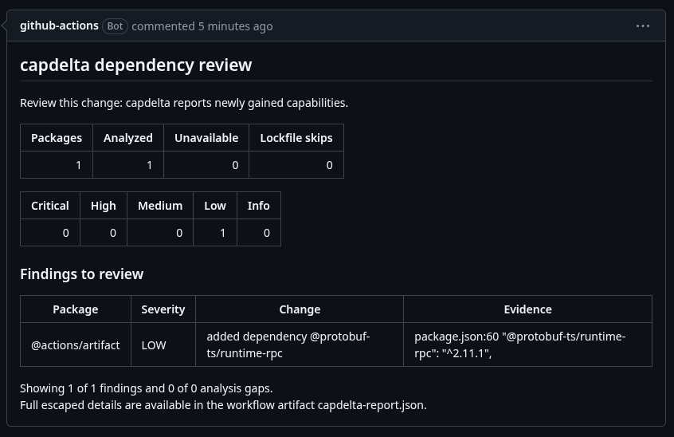
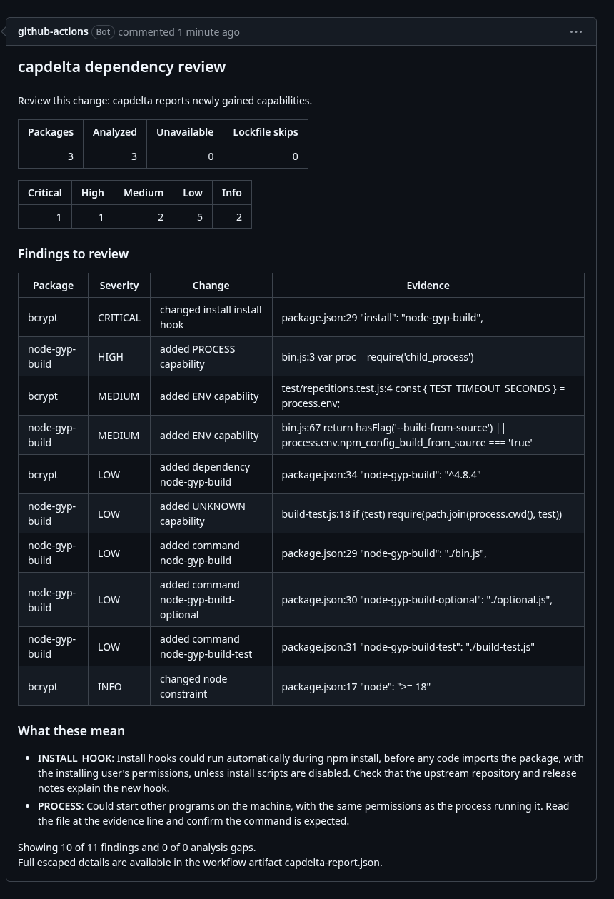

# capdelta

Review what an npm dependency gained between two lockfiles.

[](https://github.com/Volkiaa/capdelta/actions/workflows/ci.yml)
[](https://scorecard.dev/viewer/?uri=github.com/Volkiaa/capdelta)
[](LICENSE)

Traditional vulnerability scanners ask whether a version is already known to be
vulnerable. capdelta asks a different question: **what can the new version do
that the old version could not?** A newly added install script, process launch,
network client, secret-file read, or dynamic-code primitive is review-worthy
before a CVE exists.

> **Status: pre-release, under active development.** The repository is public,
> but the npm package is private, unpublished, and versioned `0.0.0`. The CLI
> and the GitHub Action work end to end, and the first formal false-positive
> measurement is [below](#measured-results-2026-10-12). A v2 platform service
> that watches the npm registry and shares reviewed findings is in
> [the platform section](#platform-service-and-shared-intelligence). capdelta is suitable for
> development and evaluation, not production enforcement. No detection rate has
> been measured; the attack reconstructions are modeled cases.

[Roadmap status](#roadmap-status) lists what has shipped and what comes next.

## Contents

- [How it works](#how-it-works)
- [What capdelta detects today](#what-capdelta-detects-today)
- [Severity means review priority](#severity-means-review-priority)
- [Quick start](#quick-start)
- [Show it working](#show-it-working)
- [Platform service and shared intelligence](#platform-service-and-shared-intelligence)
- [Security model](#security-model)
- [Dogfooding evidence](#dogfooding-evidence)
- [Architecture decisions](#architecture-decisions)
- [Roadmap status](#roadmap-status)
- [Contributing and security reports](#contributing-and-security-reports)
- [License](#license)

## How it works



Source: [docs/diagrams/pipeline.html](docs/diagrams/pipeline.html)

When the lockfile did not change, capdelta exits before any parsing or network access. Changed tarballs are verified
byte-for-byte against lockfile SRI before extraction. Package code is never imported or
executed. The npm-specific lockfile and extractor implementations sit behind core
contracts so another ecosystem can add adapters without rewriting the Differ or Reporter.

See [docs/resource-limits.md](docs/resource-limits.md) for the default deadlines and caps.

## What capdelta detects today

capdelta analyzes every direct and transitive npm package whose resolved
lockfile artifact changed. Removed packages are ignored. A newly added package
has no baseline, so its complete capability set is reported.

The manifest layer detects additions or behavior changes to:

- `preinstall`, `install`, and `postinstall` registry install hooks;
- `prepare` hooks, labeled as git-only;
- command entrypoints from `bin`;
- dependencies, including npm aliases; and
- runtime constraints from `engines`.

The static JavaScript layer parses `.js`, `.mjs`, and `.cjs` and detects:

- `PROCESS` — child processes and command execution;
- `NET` — HTTP, HTTPS, sockets, `fetch`, and WebSocket access;
- `FS_READ` and `FS_WRITE`;
- `FS_SENSITIVE` — literal paths near stores such as `.npmrc`, `.env`,
  `.ssh/`, AWS credentials, and GitHub CLI configuration;
- `ENV` — `process.env`;
- `DYNAMIC_CODE` — `eval`, `Function`, and `vm`;
- `NATIVE` — native addons, node-gyp, and WebAssembly loading; and
- `UNKNOWN` — dynamic imports or calls that the bounded resolver cannot
  identify honestly.

Resolution covers literal ESM/CommonJS imports and one immutable `const` alias
hop. Anything deeper becomes `UNKNOWN`; capdelta does not pretend to perform
general JavaScript dataflow. Literal files invoked by install hooks retain
install-time location context.

Lockfile-level facts are also surfaced: same-version integrity changes,
downgrades, unanalyzable git/file/link sources, private registries, malformed
entries, and first-run lockfile additions. Each lockfile finding appears as a
row in the PR comment's findings table under the same row cap, order, and
count as package findings, and as one `CAPDELTA-LOCKFILE-<KIND>` SARIF result
located at the lockfile.

### Measured results (2026-10-12)

At a frozen policy, on 90 assumed-benign bumps across 30 pre-registered packages
(single-package diffs, all 90 analyzed), the default CRITICAL gate failed on **2 / 90**.
Both were real registry install-hook command changes (`bcrypt` 6.0.0, `sqlite3`
5.1.7), which capdelta intends you to review; neither gate failure was noise. One
bump, `yargs` 17.7.3 to 18.0.0, had a HIGH finding for a documentation link in a
string literal, which the record labels as noise. Separately, 11 bumps would fail
`--strict` because of TypeScript sources or an unparseable file. This is a selected,
clustered sample with single-reviewer labels, not an ecosystem false-positive rate.
The method, frozen inputs, raw results, and every label are in
[docs/m5-2026-10-12](docs/m5-2026-10-12/README.md). That frozen record predates
ADR-016, so its scenario table still shows the axios dropper over an extraction cap
as passing; the evasion section below describes current behavior.

### Attack reconstructions

Defanged, synthetic reconstructions of documented npm compromises run through the full
lockfile → fetch → static analysis → default gate path (`src/core/attack-reconstructions.test.ts`).
They are modeled on public analyses, labeled as reconstructions, and never contain the
original artifacts. Each of the three incident reconstructions has a benign control
bump that must pass.

| Incident                                                                                                                                        | Modeled delta                                                                                                                    | Why capdelta fails the default gate                                                                                                                                     |
| ----------------------------------------------------------------------------------------------------------------------------------------------- | -------------------------------------------------------------------------------------------------------------------------------- | ----------------------------------------------------------------------------------------------------------------------------------------------------------------------- |
| [axios](https://github.com/axios/axios/issues/10636), 2026-03-31                                                                                | `axios@1.14.1` adds only a dependency; new `plain-crypto-js@4.2.1` has `postinstall: node setup.js` with an encoded string table | The new package gets a full report: CRITICAL registry `postinstall` hook, `UNKNOWN` in install code; the axios bump shows a LOW dependency addition cross-linked to it  |
| [Shai-Hulud](https://sysdig.com/blog/shai-hulud-the-novel-self-replicating-worm-infecting-hundreds-of-npm-packages), 2025-09                    | `@ctrl/tinycolor@4.1.1` adds `postinstall: node bundle.js`; the bundle reads tokens, runs a scanner, posts to a GitHub API       | CRITICAL hook, plus `NET`/`ENV`/`PROCESS` in install code and the secret-exfiltration shape. With the bundle over the parser limit, the hook alone still fails the gate |
| [Shai-Hulud 2.0](https://www.endorlabs.com/learn/shai-hulud-2-malware-campaign-targets-github-and-cloud-credentials-using-bun-runtime), 2025-11 | `preinstall: node setup_bun.js` loader plus an encoded payload                                                                   | CRITICAL registry `preinstall` hook                                                                                                                                     |

These show that capdelta flags the modeled dependency and lifecycle deltas. They are not
the original malware, not a measured detection rate, and not proof that encoded payloads
are decoded. Sources and every kept or omitted behavior are recorded in `test/fixtures/reconstructions/inventory.json`.

## Severity means review priority

capdelta reports capability gains, not a malware verdict. Shape rules can
promote otherwise ordinary capabilities when their combination or location is
more dangerous.

| Priority     | Current examples                                                                                                                                                                  |
| ------------ | --------------------------------------------------------------------------------------------------------------------------------------------------------------------------------- |
| **CRITICAL** | Registry install hook added/changed; `NET`, `PROCESS`, `ENV`, or `FS_SENSITIVE` in install code; `NET` plus secret access; `DYNAMIC_CODE` or `NATIVE`; tarball integrity mismatch |
| **HIGH**     | `NET`, `PROCESS`, or `FS_SENSITIVE` gain; integrity changed while version stayed the same                                                                                         |
| **MEDIUM**   | `ENV` or `FS_WRITE` gain                                                                                                                                                          |
| **LOW**      | `FS_READ`, `UNKNOWN`, command entrypoint, or dependency gain                                                                                                                      |
| **INFO**     | Runtime-constraint change, git-only hook, downgrade, or other review context                                                                                                      |

Within each package, findings are ordered from CRITICAL through INFO in JSON and
text. The size-capped PR table prioritizes findings globally before selecting
its detail rows. Every capability finding includes escaped, length-bounded
`file:line` evidence and a snippet. Copy says “review this change,” never
“malware detected.”

### What each finding means

CRITICAL and HIGH changes carry two reviewer lines: `Why:` describes what the
code could do, and `Check:` says what to verify. The text report prints them
under each finding, shape, signal, and severity-bearing analysis issue; the PR
comment adds one deduplicated “What these mean” section; and each SARIF rule
puts them in its help text. The wording is authored by capdelta — package,
lockfile, and registry data is never interpolated into it — and keeps the same
“review this change” framing. Heuristic results (secret exfiltration, sensitive
paths, obfuscation, entropy) say what static analysis found or suggests, never
what the package is. In the PR comment the size cap cuts guidance before it
touches a finding row, and a footer says how many classes were omitted.

Lockfile findings get the same guidance. A CRITICAL or HIGH lockfile kind is
explained in the comment, as `Why:` and `Check:` lines in the text report, and
in its SARIF rule help.

## Quick start

### CLI

Requirements: Node.js 22 or newer, npm, and Git.

capdelta is not published to npm. Clone it, install and build it, then run the
built CLI from the target repository, which must contain one `package-lock.json`:

```bash
git clone https://github.com/Volkiaa/capdelta.git
cd capdelta
npm ci --ignore-scripts
npm run build
cd /path/to/target-repository
node /path/to/capdelta/dist/cli.js --base main
```

The full reference for flags, exit codes, allowlists, and unanalyzable
exceptions is in [docs/cli.md](docs/cli.md).

### GitHub Action

Pin the Action to a reviewed full commit SHA rather than a mutable branch or
tag:

```yaml
name: capdelta

on:
  pull_request:
    paths:
      - package-lock.json

permissions:
  contents: read
  pull-requests: write
  security-events: write

jobs:
  review:
    runs-on: ubuntu-latest
    steps:
      - uses: actions/checkout@9c091bb21b7c1c1d1991bb908d89e4e9dddfe3e0 # v7.0.0
        with:
          ref: ${{ github.event.pull_request.head.sha }}
          persist-credentials: false
      - uses: Volkiaa/capdelta@2535ee0940e25530a8aa7de23af17467727bb00e
        with:
          github-token: ${{ github.token }}
          fail-on: CRITICAL
```

The example pin is the repository's currently dogfooded immutable Action
revision. Review and update pins deliberately when adopting a newer revision.

Fork PRs have read-only credentials, so capdelta writes the same inert summary to the
job summary, retains the JSON artifact, relies on the job conclusion for status, and
skips the comment and SARIF writes it cannot perform. Any other PR attempts the writes;
if its token lacks `pull-requests: write` or `security-events: write`, the refused write
falls back to the job summary with a warning that names the permission to add. Never work
around this with `pull_request_target` while checking out untrusted PR-head code.

If dependency updates can auto-merge, make the capdelta job a required status
check so a bump cannot merge before the configured gate runs.

Every input, output, and step is in
[docs/github-action.md](docs/github-action.md).

## Show it working

Two checks prove the tool end to end. Both use the real built CLI against real
registry data, and neither executes package code. Build first (see
[CLI](#cli)). Node.js 22 and network access are required.

**A risky bump fails the gate.** This installs bcrypt 5.1.1 in a scratch Git
repository, commits it, then installs 6.0.0 uncommitted and runs capdelta on the
change:

```bash
R="$(.claude/skills/verify-capdelta/bin/scenario bcrypt 5.1.1 6.0.0)"
cd "$R" && node /path/to/capdelta/dist/cli.js --base HEAD --fail-on CRITICAL; echo "exit $?"
```

Expected on the 2026-10-25 run: exit `1`, and the report opens with one CRITICAL
finding, `install hook changed` (`package.json:29`, `"install": "node-gyp-build"`),
plus the new `node-gyp-build` dependency. That is the behavior to show: a bump
added code that runs at install time, and the check failed before anyone merged it.
bcrypt is legitimate, so this is a review prompt and not a malware verdict.

**Confirmed intelligence blocks a release.** One command starts a real platform
service, seeds a finding, and walks it through every verdict:

```bash
.claude/skills/verify-capdelta/bin/intel-drive
```

Expected output, one line per state:

| State                            | CLI result                              |
| -------------------------------- | --------------------------------------- |
| no `--intel-url`                 | exit 0                                  |
| finding is `suspected`           | exit 0, no intel finding                |
| finding is `confirmed-malicious` | exit 1, `intel-confirmed-malicious`     |
| finding is `retracted`           | exit 0                                  |
| service stopped                  | exit 0, warning, local analysis decides |
| `--intel-url ftp://x`            | exit 64                                 |

To see a PR comment instead of terminal output, open
[PR #63](https://github.com/Volkiaa/capdelta/pull/63) or the screenshots under
[Dogfooding evidence](#dogfooding-evidence).

## Platform service and shared intelligence

`capdelta-platform` is the v2 service. It follows the npm change feed, analyzes
each new release once, stores the report, and serves it over HTTP. Named
reviewers move findings through a verdict lifecycle (`suspected`, `under-review`,
`confirmed-malicious`, `benign`, `retracted`), and the CLI and Action can ask the
service about the artifacts a bump changes.

```bash
capdelta-platform monitor --data ./data --interval 60   # follow the registry
capdelta-platform serve --data ./data --reviewers ./reviewers.json
capdelta --base origin/main --intel-url http://127.0.0.1:8787
```

The lookup sends only the artifact digest, never names or the lockfile. It can
only make the gate stricter, and a service outage becomes a warning. The
service is for localhost or a private network. It speaks plain HTTP, so put a
TLS proxy in front before exposing it. The operator guide is
[docs/platform.md](docs/platform.md), and the designs are ADR-038 to ADR-041.

Measured on 2026-10-24 ([results](docs/eval/2026-10-24/README.md)): 2 false
positives in 222 benign transitions (0.9%), 13 of 14 synthetic attacks flagged
at HIGH or above, and 6 of 14 at the default CRITICAL gate. Only 2 real
malicious releases were still available to test, so no real-world detection
rate exists. The service is not deployed anywhere yet.

## Security model

### Adversary

capdelta assumes an attacker can publish a new version of a legitimate npm
package through account takeover, a malicious maintainer, or a compromised
release pipeline. Lockfiles, manifests, tarballs, package names, URLs, report
snippets, and JavaScript source are attacker-controlled input.

### Safety controls

- package code is never imported, evaluated, or executed—not even in tests;
- tarballs are verified against lockfile SHA-512 integrity before parsing;
- extraction rejects absolute paths, traversal, links, unsupported entries,
  invalid npm layouts, and resource-limit violations;
- parsing runs statically under source-size and worker deadlines;
- lockfile symlinks are rejected and reads are capped;
- Git and child processes are shell-free, time-bounded, and forcibly detached
  if termination cannot be confirmed;
- report, terminal, Markdown, JSON, and SARIF strings are escaped or serialized
  and truncated; and
- malformed or unavailable data remains visible.

Private registries and mirrors are not authenticated in v0.1. Any host other
than `registry.npmjs.org` that base policy does not list under
`registry-hosts` is skipped and flagged.

### Known limitations and evasions

- **No-delta attacks:** behavior already present in the baseline is not newly
  reported.
- **Slow-roll attacks:** capabilities introduced across several modest releases
  can look harmless one diff at a time. A reviewed capability snapshot is
  planned for v0.2.
- **Bounded resolution:** re-exports and general JavaScript dataflow are not
  resolved. Deeper expressions become `UNKNOWN`.
- **Source coverage:** TypeScript source is analyzed after type stripping.
  Files that stripping rejects, such as those using enums, namespaces or
  parameter properties, are diagnosed as unsupported.
- **Signal coverage:** URL-domain diffs, entropy, minified-blob growth, and
  obfuscation recognizers are implemented with provisional thresholds.
- **Endpoint heuristics:** in files that parse, URLs and IPs inside comments
  are ignored, so an endpoint that code recovers from its own comment text at
  runtime may be missed. Files that do not parse are still byte-scanned,
  comments included. Domains must look public (two or more letter-digit-hyphen
  labels with an alphabetic or punycode TLD); single-label hosts are not
  reported. Non-TLD labels may also contain underscores, because DNS resolves
  them and an attacker controls their own zone's records. A new host that the
  new version mentions only inside text, meaning a string or template part
  that also holds other words (for example a help
  message `"See https://example.test/docs for details"`), is reported at LOW
  with `(mentioned in text)` instead of HIGH. A string that holds only the
  URL, or a file that does not parse, keeps HIGH. So code that builds a
  request URL out of a prose string (for example by splitting it) gets LOW,
  which ADR-024 accepts; concatenated URL pieces were already not detected.
- **Script semantics:** install hooks are never executed. Only conservative
  literal `node path.js` entrypoints receive install-code attribution.
- **Routine hooks:** no install command is ranked down. Benign-pattern
  suppression stays unimplemented until a corpus containing real install-hook
  additions justifies it (PLAN §6), so a routine-looking `node-gyp rebuild`
  addition is reported at the same severity as any other new registry hook.
- **Resource limits and rejected entries:** a package whose tarball exceeds
  the fetch or extraction caps, or contains an entry capdelta refuses (any
  link, unsafe path, or unsupported type), is reported as unavailable. Its
  install hook is never read. Such an artifact- or lockfile-controlled failure
  is CRITICAL by default: capdelta did not inspect the package, so the default
  gate fails until a person reviews it (ADR-016). A reviewed `unanalyzable:`
  exception (ADR-017) can release an extraction- or manifest-stage failure from
  the default gate, but only for the exact new-side bytes it names; a tarball
  over the download cap fails before verification and cannot be excepted.
  `--strict` still returns exit 2. The axios reconstruction includes a test
  that records this boundary. A non-retryable HTTP status, such as a `resolved`
  URL that 404s, is CRITICAL in the same way (ADR-018). A transient fetch
  failure that outlives its retries, a residual `filesystem-error` during
  extraction, an unreadable `package.json` (`manifest-unreadable`), or a
  package the deadline or cancellation left unanalyzed fails the run with exit
  1 even under `--fail-on none` (ADR-018, ADR-019). A package whose old version
  alone has a CRITICAL extraction or manifest failure, while the new version
  reads cleanly, is analyzed as newly added (ADR-023). An operational old-side
  failure still fails the run with exit 1. Its report lists every
  capability of the new version as added and gates them normally, and it shows
  the old failures as `baselineFailures`, which count as analysis issues but
  never add to `summary.gateSeverity`. `--strict` still returns exit 2, and a
  reviewed `unanalyzable:` exception is only needed when the new side fails.
- **Registry scope:** private registries, mirrors not named in
  `registry-hosts`, git, file, and link dependencies are skipped and surfaced
  as unanalyzed.
- **Single ecosystem and lockfile:** npm lockfile v2/v3 only, one lockfile per
  invocation.
- **Configuration:** allowlists and `--strict` are implemented; full-inventory
  mode remains future work.

These are product limits, not claims that the corresponding attacks are safe.
Report silent bypasses or unsafe parsing privately through
[SECURITY.md](SECURITY.md).

## Dogfooding evidence

The repository's own lockfile PRs run the Action through
[the dogfood workflow](.github/workflows/capdelta.yml), and Dependabot supplies
real dependency traffic. In [PR #7's reviewed esbuild finding](https://github.com/Volkiaa/capdelta/pull/7#issuecomment-5108797671),
capdelta raised a CRITICAL install-time capability shape. The finding was
manually accepted because esbuild's documented installer legitimately selects
and validates a platform binary. This is the intended meaning of CRITICAL:
powerful behavior that requires review, not an automatic malware accusation.

On [Dependabot PR #63](https://github.com/Volkiaa/capdelta/pull/63), which bumps
`@actions/artifact` from 6.2.1 to 6.3.1, capdelta posted this comment and uploaded
SARIF. Since ADR-020, the Action writes whenever the workflow's token allows it, so
Dependabot PRs get the same review as any other PR.



A gate failure looks like this. A throwaway demo PR bumped `bcrypt` from 5.1.1 to
6.0.0, one of the two M5 gate failures above. capdelta failed the check on the
CRITICAL install-hook change and listed the new `node-gyp-build` dependency's
capabilities. The PR was closed unmerged.



capdelta currently has eight direct runtime dependencies: `@actions/artifact`,
`@actions/core`, `@actions/github`, `acorn`, `acorn-walk`, `amaro`, `jsonc-parser`,
and `tar`. The platform service adds none. The `@actions/*` packages are bundled into `dist/action` and listed in
the release SBOM. `npm run check:deps` counts all eight against the limit of
fewer than 10, and CI fails at 10. Transitive runtime packages are reported by
the check but are not the gate.

## Architecture decisions

- [ADR-001: TypeScript](docs/adr/0001-typescript.md)
- [ADR-002: Static-only analysis](docs/adr/0002-static-only-analysis.md)
- [ADR-003: Analyze all changed packages](docs/adr/0003-transitive-all-packages.md)
- [ADR-004: Ecosystem interface boundary](docs/adr/0004-ecosystem-interface-boundary.md)
- [ADR-005: Shape-based severity](docs/adr/0005-shape-based-severity-from-capdiff.md)
- [ADR-006: Preserve old resolved URLs](docs/adr/0006-changedpackage-carries-old-resolved-url.md)
- [ADR-007: Moved-package matching](docs/adr/0007-moved-package-matching-rule.md)
- [ADR-008: Differ emits facts](docs/adr/0008-differ-emits-facts-not-severities.md)
- [ADR-009: Non-npmjs hosts are private](docs/adr/0009-non-npmjs-host-is-private.md)
- [ADR-010: Preflight extraction and reject links](docs/adr/0010-preflight-and-reject-links-in-npm-tarballs.md)
- [ADR-011: Bound extraction resources](docs/adr/0011-bound-npm-tarball-extraction-resources.md)
- [ADR-012: Acorn parser and bounded honesty tier](docs/adr/0012-acorn-ast-parser.md)
- [ADR-013: Analyze npm tarballs with npm's strip-one layout](docs/adr/0013-npm-strip-one-tarball-layout.md)
- [ADR-014: Run the GitHub Action on Node 24](docs/adr/0014-node24-action-runtime.md)
- [ADR-015: Read allowlist policy from the base commit](docs/adr/0015-policy-from-base-commit.md)
- [ADR-016: Fail the default gate on packages capdelta cannot analyze](docs/adr/0016-fail-closed-on-unanalyzable-packages.md)
- [ADR-017: Reviewed exceptions for unanalyzable packages](docs/adr/0017-reviewed-unanalyzable-exceptions.md)
- [ADR-018: Fetch failures fail the run instead of passing it](docs/adr/0018-fetch-failures-fail-closed.md)
- [ADR-019: Read what npm installs, and fail on every unread package](docs/adr/0019-read-what-npm-installs.md)
- [ADR-020: Decide write access from the token, not from the PR author](docs/adr/0020-decide-write-access-from-the-token.md)
- [ADR-021: Rebuild the Action bundle in a credential-free sandbox](docs/adr/0021-credential-free-action-rebuild.md)
- [ADR-022: Release the Action from CI only, behind an approval, with signed provenance](docs/adr/0022-release-from-ci-with-provenance.md)

The authoritative architecture and roadmap remain in
[docs/PLAN.md](docs/PLAN.md). Session handoffs are recorded in
[docs/SESSIONS.md](docs/SESSIONS.md).

## Roadmap status

### Shipped

- **M0-M3.** Scaffolding, the manifest CLI, secure retrieval and extraction,
  Action reporting, the AST taxonomy, shape severity, SARIF, dependency
  cross-linking, and the false-positive harness are on `main`.
- **Post-M3 checkpoint.** All 60 selected assumed-legitimate bumps were
  analyzed; 54 had no findings, all 16 findings were LOW/INFO, and no bump
  tripped the default CRITICAL gate. The detailed corpus record documents the
  diagnostic-noise and tuning observations.
- **M4, except benign-pattern suppression.** Signals, justified allowlists,
  strict mode, bounded scheduling, loud partial-analysis reporting, and
  malformed-input property tests are implemented. Benign-pattern suppression is
  deliberately deferred: PLAN §6 requires it be driven by post-M3
  false-positive data, and the 2026-07-29 corpus produced no install-hook
  findings to drive it.
- **Fail closed on unanalyzable packages.** A changed package that capdelta
  cannot fetch, extract, or read fails the run, with reviewed exceptions for
  the cases that allow one (ADR-016 to ADR-019).
- **Finding guidance.** Capability, signal, and analysis-failure findings
  explain why they matter and what to check, in the text report, the PR
  comment, and SARIF rule help.
- **First formal measurement.** The 2026-10-12 false-positive study
  [above](#measured-results-2026-10-12).
- **Dependabot demo.** Dependabot PRs get the sticky comment and SARIF (ADR-020);
  see [the dogfooding evidence](#dogfooding-evidence).
- **URLs mentioned in text.** A new host seen only inside prose is LOW (ADR-024).
  On the 2026-10-20 held-out corpus, all 82 such observations were prose; see
  [the measurement](docs/heldout-2026-10-20/README.md#after-adr-024).

- **V2 platform (phases 1 to 3).** The registry monitor, release store, job
  queue, HTTP API, reviewed baselines, the intelligence model with reviewer
  tokens, the `--intel-url` consumer, and labeled evaluation tooling
  (PRs #169 to #192, ADR-038 to ADR-041).

### Next

1. Decide on the open overnight drafts, add a driven proof for the Action's
   `intel-url` input, and deploy the service behind TLS. Phases 4 and 5 of the
   [v2 roadmap](docs/v2-roadmap.md) are not started.
2. Cut v0.1.0 and verify the signed provenance and SBOM for both Action
   bundles.
3. M5 publication of the measured results.
4. Noise reduction for published TypeScript (zod's `unparseable-file`
   findings) and IPv6 literals in minified data.

## Contributing and security reports

See [CONTRIBUTING.md](CONTRIBUTING.md) for the design-first workflow, required checks,
dependency budget, and inert-fixture rules. Report suspected vulnerabilities privately
according to [SECURITY.md](SECURITY.md), not in a public issue or pull request.

## License

Apache-2.0. See [LICENSE](LICENSE).
